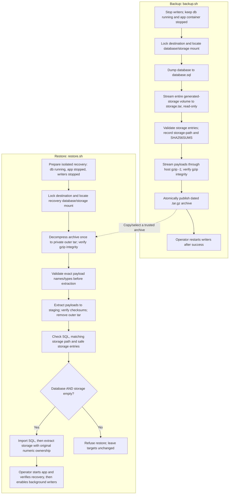

# Backup and restore

Run these scripts from the repository root.

- `backup.sh` saves the database and the entire generated-storage volume, including thumbnails and video previews, into one `.tar.gz` file.
- `restore.sh` restores a file created by `backup.sh` into an empty database and empty generated-storage volume.

Original photos/videos and your configuration/secrets are **not included**. Back them up separately.

## Quick start

Run from the repository root on the Docker host. Replace the example project and paths with your installation's settings.

**Backup:** stop all writers, leave `db` running and keep the stopped app container:

```sh
docker compose -f docker-compose-prod.yml --env-file /secure/hmv.env -p media stop scheduler app background
bash scripts/backup/backup.sh \
  --compose-file docker-compose-prod.yml --env-file /secure/hmv.env \
  --project media --destination /srv/backups/hmv
# After a successful backup:
docker compose -f docker-compose-prod.yml --env-file /secure/hmv.env -p media up -d app background scheduler
```

Also stop migrations, test runners and external writers. The script prints the new archive's path; previous backups remain in place.

**Restore:** first [prepare an isolated recovery installation](#restore-a-backup) with an empty database and storage volume, a running `db`, and a stopped app container using the original `APP_STORAGE_PATH`. Then run:

```sh
bash scripts/backup/restore.sh /srv/backups/hmv/hmv-media-all-20261105T193000123456789Z.tar.gz \
  --compose-file /secure/recovery.yml --env-file /secure/recovery.env \
  --project recovery --destination /srv/backups/hmv
```

Use your actual archive filename. Follow the recovery steps below to start and verify the app before enabling background processing. `--destination` selects the staging/lock directory; the recovery Compose configuration selects the restore targets.

## Process overview

Both operations keep writers stopped, leave the database running, and use a private staging directory under `--destination`. Original media and configuration/secrets are backed up separately.



Any failed step stops the script and cleans its staging directory. Backup failures do not publish a new archive. Restore validation failures occur before target writes; an import or storage extraction failure can leave partial data and requires fresh empty targets before retrying. Starting/stopping application services is an operator step, not performed by the scripts.

## Requirements

Use Linux with Bash, Docker Compose v2, GNU tar/coreutils, gzip and flock. Python and jq are not required. Run the entry points on the Docker host, using an account allowed to access the Docker daemon and write the destination directory. The scripts run database commands inside `db` and short-lived storage helpers using the stopped app container's exact image. That image must provide `sh`, `tar` and `find`; helpers run as root with networking disabled.

The database container must expose `MARIADB_DATABASE` and `MARIADB_ROOT_PASSWORD` and provide `mariadb`/`mariadb-dump`. The scripts use those settings, not `DATABASE_URL`. Confirm that the application actually uses that database before relying on a backup.

Both scripts use these options:

| Option | Meaning |
| --- | --- |
| `--compose-file` | One Compose file for the installation. Repeating this option replaces the previous value; it does not merge files. |
| `--env-file` | Environment file for that installation. |
| `--project` | Its existing Compose project name, matching `docker compose -p`. |
| `--destination` | Private directory for backups, temporary files and the backup lock. This does **not** choose the database or volume to restore. |

The selected Compose project's `db` and `app` containers determine the database and storage volume. Use a destination outside your media/storage directories, with enough free space for temporary files and the archive. Keep backups private. Existing destination directory permissions are not tightened automatically. For example, provision a directory owned by the operator with:

```sh
install -d -m 700 /srv/backups/hmv
```

All four options are required; there are no positional backup options, `--help`, dry-run, overwrite, scope or retention switches. Restore requires the archive as its **first** argument. Quote paths containing spaces. Project names must match `^[a-z0-9][a-z0-9_-]*$`.

Use the exact existing project name, even if Compose normally derives it from a directory. You can identify projects and service states without displaying secrets:

```sh
docker compose ls
docker compose -f docker-compose-prod.yml --env-file /secure/hmv.env -p media ps --all
```

These examples assume the production service layout. Development Compose has no `background` service; stop/start only services present in your installation. If deployment uses multiple Compose files, prepare a single equivalent configuration with correct absolute paths and protect it as a secret-bearing file. Do not pass repeated `--compose-file` arguments. Shell environment variables can override values from `--env-file`; use a controlled deployment shell.

## Create a backup

Example installation: project `media`, Compose file `docker-compose-prod.yml`, environment file `/secure/hmv.env`.

1. Stop the application writers. Leave the database running:

   ```sh
   docker compose -f docker-compose-prod.yml --env-file /secure/hmv.env -p media stop scheduler app background
   ```

   Also stop any running migrations, test runners or external imports. The scripts refuse to run while app/background/scheduler/migration/testrunner containers are running. Keep the stopped app container; the scripts need it to find storage. Stop external writers as well: the service-name check cannot detect processes outside the selected Compose project. Prevent automation or another operator from restarting writers until the backup finishes.

2. Create the backup:

   ```sh
   bash scripts/backup/backup.sh \
     --compose-file docker-compose-prod.yml \
     --env-file /secure/hmv.env \
     --project media \
     --destination /srv/backups/hmv
   ```

   On success, the script prints the created file, for example:

   ```text
   Backup created: /srv/backups/hmv/hmv-media-all-20261105T193000123456789Z.tar.gz
   ```

   The filename includes the UTC date and time. Each backup contains `database.sql`, `storage.tar`, `storage-path` and `SHA256SUMS`. Previous backups are kept. `all` is a fixed filename label for database plus generated storage; it does not mean original media is included.

   The SQL dump uses a single transaction, quick streaming, routines, events, triggers and hex-encoded binary values. Storage is copied read-only after writers have stopped. The script computes SHA-256 checksums, streams the final tar package through host-side `gzip -1` and checks the gzip archive, then publishes it by renaming within the destination. A failed dump or storage copy does not publish a final backup.

3. Start the application again:

   ```sh
   docker compose -f docker-compose-prod.yml --env-file /secure/hmv.env -p media up -d app background scheduler
   ```

If backup fails, investigate the error before relying on the backup or restarting services. Copy successful backups to protected off-host storage.

## Restore a backup

**Both the target database and generated-storage volume must be empty.** The script does not overwrite an existing installation. Try recovery in a separate Compose project first.

Prepare `/secure/recovery.yml` and `/secure/recovery.env` for a project named `recovery`. Configure fresh database/storage volumes; do not reuse the original installation's volumes. Use the original application and MariaDB versions, the same `APP_STORAGE_PATH`, and mount your separately recovered original media at its original container paths. Do not run migrations or seed before restoring. The database itself should exist, initialized by MariaDB, but have no tables. Fresh database credentials may differ from the source as long as the recovery deployment's database users and application connection settings agree.

A different project name alone is insufficient if your Compose file uses explicit volume names, external volumes, bind mounts or fixed host ports. Inspect the recovery configuration locally and ensure database/storage targets and ports are isolated. Preserve relative Compose references (such as `extends` and database initialization scripts) when preparing `/secure/recovery.yml`; simply copying the repository file to another directory can break them. Have the matching app image available before creating its container; avoid building a different release during recovery.

1. Start only the database and wait for it to be healthy. Create the app container without starting it:

   ```sh
   docker compose -f /secure/recovery.yml --env-file /secure/recovery.env -p recovery up -d --wait db
   docker compose -f /secure/recovery.yml --env-file /secure/recovery.env -p recovery up --no-start --no-deps app
   ```

2. Restore the backup file:

   ```sh
   bash scripts/backup/restore.sh \
     /srv/backups/hmv/hmv-media-all-20261105T193000123456789Z.tar.gz \
     --compose-file /secure/recovery.yml \
     --env-file /secure/recovery.env \
     --project recovery \
     --destination /srv/backups/hmv
   ```

   Replace the example filename with your actual backup file. On success, the script prints:

   ```text
   Restore completed. Verify the application before starting writers.
   ```

3. Start the recovered app without starting its dependencies again:

   ```sh
   docker compose -f /secure/recovery.yml --env-file /secure/recovery.env -p recovery up -d --no-deps app
   ```

   Check login, albums, original media and thumbnails. Confirm storage is writable by the application. This check starts the real app, which may itself write data; only proceed once the restore has completed. Then enable background processing and scheduling:

   ```sh
   docker compose -f /secure/recovery.yml --env-file /secure/recovery.env -p recovery up -d --no-deps background
   docker compose -f /secure/recovery.yml --env-file /secure/recovery.env -p recovery up -d --no-deps scheduler
   ```

Restore verifies archive contents and checksums before importing SQL and extracting storage files. If an import or extraction fails, the targets may contain partial data: investigate and use fresh empty recovery targets before retrying.

## Inspect or transfer an archive

For a quick non-mutating check on a trusted backup:

```sh
archive=/srv/backups/hmv/hmv-media-all-20261105T193000123456789Z.tar.gz
gzip -t "$archive"
tar -tzf "$archive"
```

Expected top-level entries:

```text
database.sql
storage.tar
storage-path
SHA256SUMS
```

`database.sql` contains application data and migration history; `storage.tar` contains the entire generated-storage tree, including hidden files; `storage-path` records its original container path. `SHA256SUMS` covers the other three files. Restore checks the exact four regular payload files, checksum contents, matching storage path, and storage member paths/types before checking both empty targets and writing either one.

A gzip/listing check alone does not verify the internal checksums or prove recoverability. Perform periodic isolated restores. Only restore archives from trusted sources: checksums detect corruption, not malicious modification, and SQL is executed during recovery.

For off-host transfer, record a checksum next to the archive and verify it at the receiving end:

```sh
cd /srv/backups/hmv
sha256sum hmv-media-all-20261105T193000123456789Z.tar.gz > hmv-media-all-20261105T193000123456789Z.tar.gz.sha256
# After transferring both files, run in their destination directory:
sha256sum -c hmv-media-all-20261105T193000123456789Z.tar.gz.sha256
```

Archives are unencrypted and contain private database records and generated images. Protect or encrypt off-host copies using your storage policy. Keep matching release/image references, Compose settings, secrets and original media separately. Define retention outside these scripts; do not remove your last verified recovery copy.

## Performance and compatibility

Backup streams the final tar package through **host-side `gzip -1`**. This uses fast single-core compression rather than gzip's default level; archives may be larger, especially for SQL, in exchange for less compression work. Thumbnail JPEGs are already compressed, so further size savings are usually limited. There is no new dependency or compressor selection: `pigz` is not used. Parallel gzip remains a possible future option but would require dependency and CPU-use controls.

The storage helper already sends one tar stream through Docker. Creating a compressed file inside the container and copying it afterwards would add a temporary copy and disk read; this implementation keeps the existing streaming transfer. All files in the generated-storage volume are included without checking extensions or database usage. Original media mounts are excluded.

Restore now decompresses the gzip stream **once**, checking its integrity as it writes a private temporary outer tar. It validates payload names and types in that tar before extracting payloads, and checks payload checksums and empty targets before importing anything. Previously it decompressed the archive four times. This saves decompression work at the cost of additional staging space; uncompressed tar validation still requires disk reads. On slow disks, the extra temporary write/read can offset the CPU savings, so fewer decompression passes do not guarantee a shorter total restore. Both existing default-compression Bash backups and new fast-compression backups use the same four-payload format and remain compatible with the Bash restore/monitor interfaces. Older Python/scoped formats remain unsupported.

For the reported 90,000 thumbnail files, extrapolating the small test system's 90 generated files (10,487,150 bytes) suggests about **10.5 GB of payload**, if average sizes match. At that size, allow roughly 21 GB for restore staging, plus the input archive and headroom, separately from target volumes and existing backups. This is a sizing estimate, not a production benchmark. Runtime depends on CPU, storage throughput and small-file creation costs; no production-scale fixture or timing test was run. Writers must stay stopped throughout either operation.

## Space, locking and failure recovery

Allow a maintenance window for the full dump, storage copy and compression. During backup the destination holds the uncompressed SQL and storage tar **plus** the new compressed archive, alongside existing backups. During restore it first decompresses the archive once to a private outer tar, then extracts the SQL dump and storage tar beside it. Peak staging therefore needs approximately **twice the uncompressed payload size**, in addition to the input archive if stored on the same filesystem. The outer tar is deleted after payload checksum verification; target database/storage volumes also need capacity. Compression ratios and database disk requirements vary, so do not size free space from the compressed archive alone.

Each destination has a persistent `.backup.lock`; a second operation using it fails immediately. The lock file remaining after success is normal; do not delete it to bypass an active operation. Different destinations do not coordinate, so use one maintenance destination for concurrent access to the same installation. A `.backup-work-*` directory is removed on normal exit and handled interrupts; forced termination or host failure may leave one. Confirm no operation is active before removing an abandoned staging directory.

| Error or symptom | Action |
| --- | --- |
| Stop app/background/scheduler/migration/testrunner | Stop all running instances, including one-off/profiled containers in the selected project; keep writers stopped. |
| Exactly one running db / create exactly one stopped app | Recheck project/file/environment selection, start only `db`, and create one app container without dependencies. |
| Expected a direct mount / nested mount / unsupported links | Use one volume or bind mount exactly at `APP_STORAGE_PATH`; remove unsupported storage layout only after assessing your installation. |
| Restore requires the same APP_STORAGE_PATH | Recreate the stopped recovery app with the original container storage path and correct mount. |
| Restore database/storage must be empty | Select fresh recovery targets. The scripts provide no clearing or overwrite operation. Hidden storage files count as data. |
| Unsupported/incomplete archive, checksum mismatch, gzip/tar error | Verify transfer and select a known-good Bash-format backup. Older Python/scoped formats are unsupported. |
| Database authentication/dump/import failure | Check database health, container credentials and available disk space without printing secrets. |
| Import or storage extraction fails after writing begins | Treat both targets as partial; investigate and provision fresh empty targets before retrying. There is no transactional rollback across database and storage. |

Both scripts exit nonzero on failure. A successful backup prints `Backup created: ...`; successful restore prints `Restore completed. Verify the application before starting writers.` Keep the original installation available until recovery is verified. Never use a shared-volume deletion command as a shortcut to prepare recovery.

## Notes

- All generated storage at `APP_STORAGE_PATH` (default `/mnt/storage`) is included. It must be a direct volume or bind mount. Nested mounts, links and special files are unsupported.
- File ownership and permissions are preserved. Database accounts/grants come from your deployment settings; application records and migration history come from the SQL dump.
- Commands sharing a destination cannot run concurrently. Temporary files are removed when a command exits.
- These scripts restore the new Bash backup format. Old Python/scoped backup formats are unsupported.

## Development checks

Run the focused tests in Docker:

```sh
docker compose run --rm --no-deps -e PYTHONDONTWRITEBYTECODE=1 -v "$PWD:/workspace:ro" dependencies python3 /workspace/docker/test/backup.test.py
docker compose run --rm --no-deps -e PYTHONDONTWRITEBYTECODE=1 -v "$PWD:/workspace:ro" dependencies python3 /workspace/docker/test/operations-monitor.test.py
```

Python is used only by the tests. For a real isolated MariaDB/storage backup-and-restore drill, run `python3 docker/test/setup-lifecycle.test.py`. It orchestrates Docker and cleans up its private projects.

## Verification performed (2026-11-07)

The twelve command-level backup tests and four monitoring tests passed. Backup tests execute the Bash entry points with a simulated Docker CLI and cover hidden/binary files, private archive permissions, retained backups, writer refusal, populated targets, failed queries/dumps/copies, corrupt/incomplete/unsafe/truncated archives, duplicate/nonregular payloads, unsupported links, host packaging/compression failures and compatibility with previous Bash-format backups.

The live lifecycle drill uses two disposable Compose projects with real MariaDB and generated-storage volumes. It verifies SQL row recovery, thumbnail bytes, original-media exclusion and preservation, and persistence after restarting the restored database. It uses a tooling image for the stopped app/storage helper; it does not verify production app startup, browser login, production-size timing, or a complete real-world media library. Follow the application checks above for your installation.
